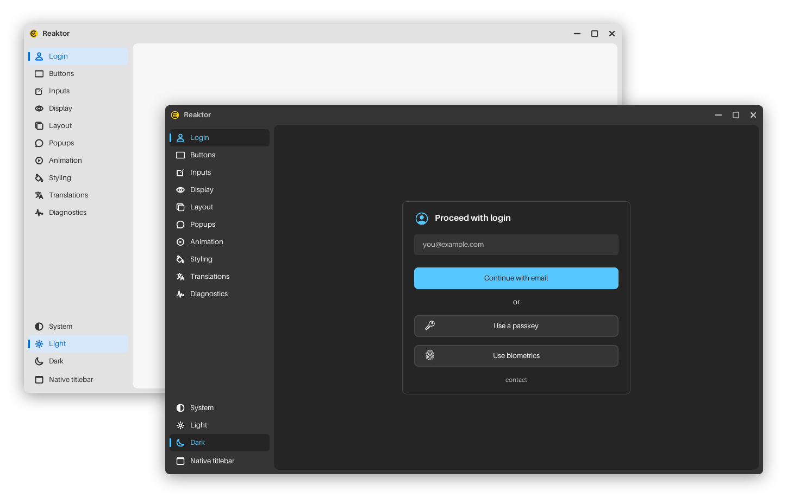
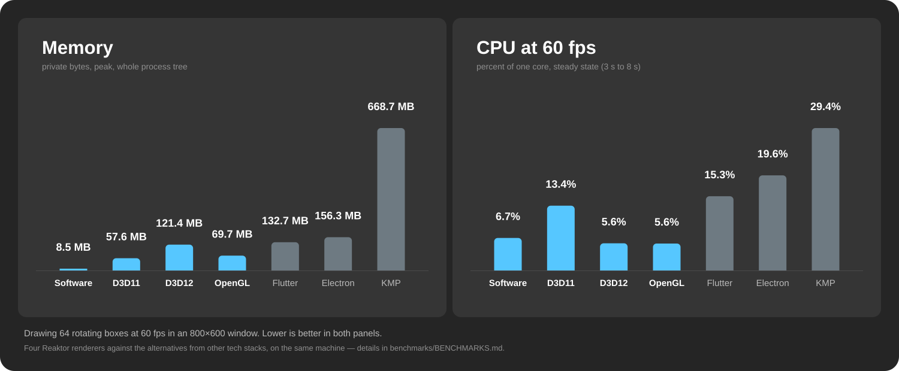

# Reaktor

A Nuklear-powered GUI library for C.

<p align="center">
  
</p>

Tired of C having no cross-platform GUI — nothing like
[Avalonia](https://github.com/avaloniaui/avalonia),
[Shaft](https://github.com/ShaftUI/Shaft) or
[Freya](https://github.com/marc2332/freya) — and of toolkits that want hundreds
of megabytes to put a dialog on screen? No? But I was, so I wrote Reaktor:
complete without being big. A 2.4 MB binary, about 10 MB of RAM, and no GPU
required.

**[Try the showcase in your browser](https://alpaq92.github.io/Reaktor/)** — the
same program, built to WebAssembly — or
**[download it](https://github.com/Alpaq92/Reaktor/releases/latest)** for
Windows, macOS, Linux, FreeBSD, OpenBSD or NetBSD, or as WebAssembly to serve
yourself.

> ⚠️ **Reaktor is in active development**, and breaking changes might occur.

<p align="center">
  <a href="docs/PERFORMANCE.md"></a>
</p>

How, and on what, is in [PERFORMANCE.md](docs/PERFORMANCE.md).

## Features

- **24 declared widgets** — buttons, fields, checks, radios, sliders, knobs,
  spinners, combos, a color picker, date and time pickers, sidebar, tabs, a
  menu bar, tables, trees and a splitter, with tooltips; rows drag between
  lists; all of Nuklear underneath, under Reaktor's names.
- **Layers** — menus in windows of their own, in-window dialogs, questions,
  toasts, more windows, and a tray icon with a menu.
- **Services** — system open, save and folder pickers, timers, main-thread
  posting, settings that persist, an undo stack, system notifications, and
  printing and PDF export.
- **Styled by CSS** read at run time: color, type, borders, radii, spacing,
  `:hover` and `:active`, light and dark. Swap the sheet and the app changes.
- **Accessible with no code** — UI Automation, NSAccessibility, AT-SPI and a
  DOM subtree on the web, with keyboard navigation throughout.
- **Localization** — catalogs, plural rules, and numbers, money and dates as
  each language writes them.
- **Text past Latin-1** — direction, shaping, fallback fonts and Unicode line
  breaking, so Japanese wraps properly.
- **Animation** — tweens keyed per widget on 31 curves, springs, steps and
  béziers; keyframed clips staggered across a grid; motion paths,
  oscillators, noise and shakes; colors blended in five spaces; and text
  that arrives a glyph at a time, idle once everything settles.
- **Modular** — accessibility, localization, text shaping, settings, the tray,
  popup windows, notifications and printing each swap for a stub at build
  time, and only what they drew stops being drawn; every other pixel stays.
- **Windows, macOS, Linux, the BSDs and WebAssembly** from one set of sources,
  on one software rasterizer, at any display scale: x86 and ARM everywhere,
  and RISC-V on Linux ([Platforms](docs/DOCUMENTATION.md#platforms)).
- **Nothing drawn at rest** — 0% of a core while it sits there.

## Build

CMake, the submodules and a C11 compiler: Reaktor is C99, but mojibake, which
the Text module uses, is C11.

```bash
git clone --recursive https://github.com/Alpaq92/Reaktor
cd Reaktor
./build.sh          # build.ps1 on Windows
./build/showcase
```

`./build-wasm.sh` (`build-wasm.ps1` on Windows, with
[emsdk](https://emscripten.org)) builds the web versions into `build-wasm/`, to
be served over HTTP.

To build your own application, add Reaktor with `add_subdirectory` and declare
it with `reaktor_add_app`, or take a `libreaktor` package from the
[releases](https://github.com/Alpaq92/Reaktor/releases/latest) and
`find_package(reaktor)`: [In your own project](docs/DOCUMENTATION.md#in-your-own-project).

## Install

On Linux and the BSDs, one script builds libreaktor as the system's own
package (`.deb`, `.rpm`, FreeBSD, OpenBSD or NetBSD) and installs it:

```bash
sh tools/libreaktor-pkg.sh -i
```

It lands in `/opt/reaktor` (`/usr/local/reaktor` on the BSDs); build against it
with `-DCMAKE_PREFIX_PATH=/opt/reaktor`, or `pkg-config` with
`PKG_CONFIG_PATH=/opt/reaktor/lib/pkgconfig`. Remove it with the system's
package manager: `libreaktor-dev` on Debian, `libreaktor-devel` on Fedora,
`libreaktor` on the BSDs.

## Usage

```c
static char name[64];
static int  len;

REAKTOR_COLUMN(.gap = 10) {
    reaktor_label(&(reaktor_label_spec){ .text = "What is your name?" });

    reaktor_field(&(reaktor_field_spec){
        .buf = name, .len = &len, .cap = sizeof name, .hint = "Ada" });

    if (reaktor_button(&(reaktor_button_spec){ .label = "Say hello" }))
        printf("Hello, %s!\n", name);
}
```

No colors, radii, padding or font sizes: they come from a stylesheet read at
startup. Nothing for screen readers either: each widget reports its own name,
value and position.

## Made of

[Nuklear](https://github.com/Immediate-Mode-UI/Nuklear) draws the widgets.
[SDL3](https://github.com/libsdl-org/SDL) supplies the window, input, tray and
software renderer. libcss, from [LCUI](https://github.com/lc-soft/LCUI), parses
the stylesheets, and [Onlay](https://github.com/Alpaq92/Onlay), a fork of
[randrew/layout](https://github.com/randrew/layout), computes the rectangles.
[NukAnim](https://github.com/Alpaq92/NukAnim), a port of ImAnim, moves them.
Every dependency is a submodule, used as it ships; the full list is in
[NOTICE.md](docs/NOTICE.md).

## Documentation

- [DOCUMENTATION.md](docs/DOCUMENTATION.md) — the whole of it: every widget,
  layout and layer, styling, then how it works inside.
- [FAQ.md](docs/FAQ.md) — short answers to common questions.
- [DEMO.md](docs/DEMO.md) — the four programs in this repository.
- [PERFORMANCE.md](docs/PERFORMANCE.md) — what it costs, measured.
- [BENCHMARKS.md](benchmarks/BENCHMARKS.md) — the comparison, as runnable
  projects.
- [NOTICE.md](docs/NOTICE.md) — dependencies and licenses.

## License

MIT. The dependencies keep their own — see [NOTICE.md](docs/NOTICE.md).
